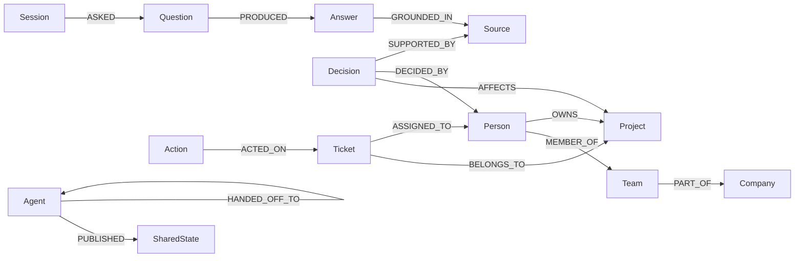

# Graph Hacks Submission: Aqua Company Brain

**Tracks:** Track 01 — Agents That Act on Connected Data; Track 02 — Agent Memory and Coordination; Track 03 — Company Brain

**Project:** Aqua, a graph-grounded private desktop agent  
**Context layer:** FalkorDB

## The company problem

Company knowledge is split between people, teams, projects, tickets, decisions, documents, and chats. Aqua's Company Brain follows those relationships in FalkorDB, acts only after graph validation, remembers the resulting trail, and returns the exact paths and records behind its answer. If FalkorDB cannot provide connected evidence, it refuses to answer.

## Track coverage

- **Track 01:** multi-hop Cypher retrieval, explainable paths, MCP/ToolHost graph tools, and graph-authorized ticket assignment.
- **Track 02:** tenant-isolated sessions, episodic answer memory, shared state revisions, and agent-to-agent handoffs persisted in FalkorDB.
- **Track 03:** connected people, teams, projects, systems, tickets, decisions, documents, and chats with source provenance and freshness controls.

## Demonstrated workflow

Ask:

> Who should handle the OAuth production incident, what earlier decision affects the fix, and which sources support the answer?

The agent:

1. Plans an incident/ownership traversal.
2. Follows `Ticket -> Project <- Person -> Team` and `Decision -> Project -> Source` connections.
3. Ranks only current, active, tenant-scoped evidence.
4. Returns structured facts, source records, and relationship paths.
5. Proposes an assignment from the ownership path.
6. After approval, revalidates ownership, creates `ASSIGNED_TO`, and records the action.
7. Stores the exchange, sources, outcome, shared state, and optional agent handoff for later sessions.

The graph therefore controls retrieval, explanation, validation, action, memory, and multi-agent coordination.

## Core agent tools

- `company.search_context`
- `company.explain_path`
- `company.propose_assignment`
- `company.assign_ticket`
- `company.record_outcome`
- `company.ingest`
- `company.open_session`
- `company.share_state`
- `company.handoff`
- `company.recall_memory`
- `company.remember_exchange`

All tools execute through Aqua's policy-aware ToolHost. Mutating operations declare side effects and require approval according to their manifests. Connection settings use protected configuration and Credential Manager rather than embedding the FalkorDB password.

## Graph model



Every company and memory query is tenant-scoped. Ingested records carry source identity, content hash, observed time, source-updated time, freshness, and active state.

## Why FalkorDB is required

Answers are composed only from returned FalkorDB evidence. There is no local-cache or sample-answer fallback. Assignment mutations first recheck the connected ticket/project/owner pattern. Memory and handoffs are stored in the graph so another agent or later session sees the same audit trail.

## Run locally

Requirements: Node.js 18+ and an accessible FalkorDB instance.

```powershell
cd apps/aqua-desktop
Copy-Item .env.example .env
# Fill in the FalkorDB values in .env. Use TLS for remote databases; the
# explicit insecure-remote override is only for synthetic-data demo endpoints
# that do not provide TLS.
npm.cmd install
npm.cmd run dev
```

Open `http://127.0.0.1:1420`, choose **Company Brain**, prepare the demo company, ask the incident question, inspect sources and paths, approve the assignment, and inspect the Memory Graph.

For normal Aqua agent runs, enable `data/tools/company_brain.json` and put the configured secret in the operating system's Credential Manager.

## Verification

Locally verified:

- Five frontend grounding/refusal/security tests pass.
- The opt-in live FalkorDB workflow passes against the configured `AquaCompanyBrain` graph, including persistence, sourced reasoning, action validation, refusal while disconnected, and recovery.
- TypeScript and Vite production build pass.
- The ingestion, retrieval, and memory modules include focused unit tests; isolated retrieval and memory harnesses passed.
- New Rust modules pass scoped `rustfmt --check`.
- `cargo check -p aqua-core --lib` passes on the development machine.
- `cargo test -p aqua-core --lib` does **not** currently compile in this working tree: several `include_str!` fixtures it needs are generated artifacts and are absent. The reproducible verification path submitted to judges is therefore the frontend gate (`npm.cmd test`, `npm.cmd run lint`, `npm.cmd run build`), which passes.

The live cloud endpoint supplied for this demo accepts plain Redis rather than TLS. The bridge therefore requires an explicit `FALKORDB_ALLOW_INSECURE_REMOTE=true` opt-in for that endpoint. Use synthetic data only and replace it with a TLS-enabled endpoint before handling confidential information. The repository CI workflow independently supplies a disposable local FalkorDB 6.0.0 gate once the project is published.

## Main implementation files

- `core/src/company_brain.rs`: ToolHost provider and eleven graph tools.
- `core/src/company_ingest.rs`: normalized ingestion, sync planning, provenance, and freshness.
- `core/src/company_retrieval.rs`: intent planning, ranking, ambiguity, refusal, and claim checks.
- `core/src/company_memory.rs`: persistent sessions, shared state, outcomes, handoffs, retention, and erasure.
- `apps/aqua-desktop/companyBrain.ts`: frontend graph retrieval and grounded answer composition.
- `apps/aqua-desktop/falkorPlugin.ts`: hardened FalkorDB development bridge.
- `apps/aqua-desktop/src/components/CompanyBrainPage.tsx`: answer, provenance, sources, and action UI.
- `apps/aqua-desktop/tests/companyBrain.test.ts`: graph-grounding behavior tests.

## Demo video outline

- **Watch on YouTube**: [https://youtu.be/8DfhnxvLxXA](https://youtu.be/8DfhnxvLxXA)
- **Local Video Asset**: `demo/video/aqua-company-brain-demo.mp4` (with captions in `demo/video/captions.srt`)
- **Release Download**: `https://github.com/vishalkushwaha/Aqua_Assistant/releases/tag/v1.0.0`

1. **Problem and graph (0:00–0:30):** show the connected company and memory model.
2. **Live retrieval (0:30–1:20):** ask the incident question and show the graph-grounded answer.
3. **Explainability (1:20–1:50):** walk through ownership, decision, and source paths.
4. **Action and memory (1:50–2:30):** approve assignment, show the mutation, then recall it from another session/agent.
5. **Dependency proof (2:30–2:50):** disconnect FalkorDB and show explicit refusal.

## AI assistance disclosure

AI coding assistance and multiple implementation agents were used for planning, TypeScript/Rust development, Cypher authoring, tests, integration, and documentation. The project owner remains responsible for live validation, credential management, security review, and final submission.
