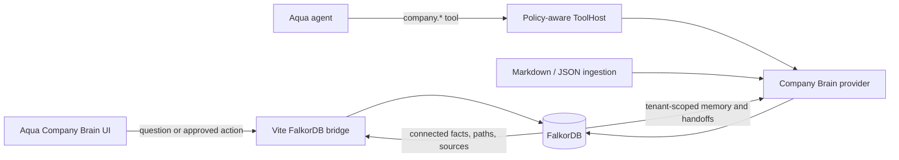
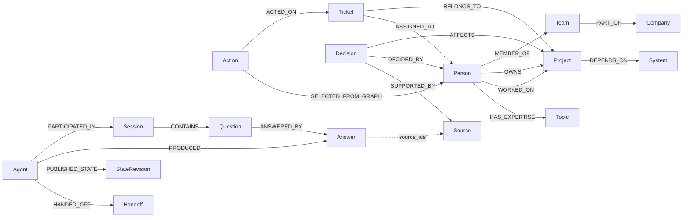

<div align="center">


# Aqua Company Brain

**Graph-Grounded Private AI Agent powered by FalkorDB**

[](https://youtu.be/8DfhnxvLxXA)
[](https://github.com/Vaibhav-tester/Aqua_Assistant/releases/tag/v1.0.0)
[](LICENSE)
[](https://www.wemakedevs.org/hackathons/falkordb)

</div>

Aqua Company Brain is a graph-grounded agent for **Graph Hacks Track 03 - Company Brain**. It connects people, teams, projects, tickets, decisions, documents, chats, actions, and agent memories in FalkorDB. The graph is not a visualization layer: it determines the answer, validates the proposed assignment, supplies the cited paths, and stores later-session and multi-agent state.

The focused demo question is:

> Who should handle the OAuth production incident, what earlier decision affects the fix, and which sources support the answer?

If FalkorDB is unavailable or no connected evidence exists, Company Brain refuses to synthesize an answer.

## What the agent does

1. Follows a multi-hop incident, project, owner, team, decision, and source path.
2. Filters inactive or stale evidence and ranks current connected records.
3. Returns the exact relationship paths and source records behind the answer.
4. Proposes and executes an assignment only when FalkorDB confirms the ownership path.
5. Stores questions, answers, actions, outcomes, state revisions, and handoffs for later sessions and agents.

## Demo Video & Walkthrough

A narrated, captioned walkthrough demonstrating live FalkorDB retrieval, explainability, graph-controlled action, persistent memory, and disconnection refusal:

[](https://youtu.be/8DfhnxvLxXA)

<p align="center">
  <a href="https://youtu.be/8DfhnxvLxXA"><strong>▶️ Click to Watch the Full Walkthrough on YouTube (1080p HD with Audio Narration)</strong></a>
</p>

> 🎬 **YouTube Video URL**: [https://youtu.be/8DfhnxvLxXA](https://youtu.be/8DfhnxvLxXA)  
> 📹 **GitHub Native Player**: [Play `aqua-company-brain-demo.mp4` on GitHub](https://github.com/Vaibhav-tester/Aqua_Assistant/blob/main/demo/video/aqua-company-brain-demo.mp4) | [💾 Download MP4](https://github.com/Vaibhav-tester/Aqua_Assistant/releases/download/v1.0.0/aqua-company-brain-demo.mp4)  
> 📝 **Captions/Subtitles**: [📄 `demo/video/captions.srt`](demo/video/captions.srt) | 📖 **Step-by-step Runbook**: [`docs/DEMO_RUNBOOK.md`](docs/DEMO_RUNBOOK.md)

### Walkthrough Timeline:
- **0:00 - 0:16**: Problem statement & tenant-scoped company knowledge model in FalkorDB.
- **0:16 - 0:32**: Live multi-hop graph retrieval (`Ticket -> Project <- Person -> Team`) and citing grounded sources.
- **0:32 - 0:40**: Graph-authorized action: revalidates ownership via Cypher before creating `ASSIGNED_TO`.
- **0:40 - 0:48**: Persistent memory recall across sessions from FalkorDB.
- **0:48 - 0:56**: Multi-agent coordination: handoff to second agent with shared graph context.

## 🖼️ User Interface & System Showcase

### 1. Neural Voice Orb & Desktop Assistant
Aqua features an always-available floating desktop **Neural Voice Orb** that handles hands-free speech, system control, and workspace context:


---

### 2. Company Brain Knowledge Graph Dashboard
Ask complex enterprise questions and receive answers composed exclusively from FalkorDB records, complete with verified multi-hop paths, citations, and authority scores:


---

### 3. Graph-Authorized Action Execution
Before modifying team tickets or triggering mutations, Aqua executes pre-flight Cypher traversals (`Ticket -> Project <- Person`) to revalidate ownership:


---

### 4. Persistent Memory Graph & Multi-Agent Coordination
Sessions, questions, answers, source citations, state revisions, and agent handoffs are saved as persistent graph entities in FalkorDB:


## Architecture



All normal Aqua tools execute through `ToolHost::call`, which validates input, applies policy and approvals, masks secrets, and audits the call. The Vite bridge is a loopback development/demo route, not a production database gateway.

## Graph model



Every company and memory record is tenant-scoped. Ingested records also carry a source identity, content hash, observed time, source update time, freshness deadline, and active state.

## How to run Aqua

Aqua is built as a complete modular system comprising:
1. **Frontend Web UI & FalkorDB Bridge** (`React + Vite + TypeScript` on Port `1420`)
2. **Aqua Core Backend Engine** (`Rust / FastServer` on Port `8767`)
3. **Windows Desktop Native UI & Floating Neural Voice Orb** (`Tauri v2 + Win32 Native Overlay`)
4. **Knowledge Graph Database** (`FalkorDB Cloud` or local Docker on Port `6379`)

You can launch everything simultaneously with the **1-Click Universal Launcher**, or start each component individually.

---

### Option 1: 1-Click Universal Launcher (Recommended)

To start the **complete project** (Backend Core + Frontend + FalkorDB Bridge + Windows Desktop UI & Voice Orb) with a single command:

#### On Windows (Double-Click or Terminal):
Double-click `start.bat` in the repository root, or run in PowerShell:

```powershell
.\start.bat
# or
powershell -ExecutionPolicy Bypass -File .\start.ps1
# or
npm start
```

**What this does automatically:**
1. Verifies local paths and configuration (`AQUA_WORKSPACE_ROOT`, Kokoro neural TTS models).
2. Cleanly terminates any stale background processes on ports `8767` and `1420`.
3. Boots the **Frontend & FalkorDB Graph Bridge** on `http://127.0.0.1:1420`.
4. Spawns the **Aqua Core Backend** and **Windows Desktop UI & Floating Voice Orb** (`aqua-desktop.exe`).
5. Opens your default web browser directly to `http://127.0.0.1:1420/`.

---

### Option 2: Running Components Individually

If you prefer to run or debug specific tiers separately, follow these steps:

#### 1. Database (FalkorDB)
Choose either FalkorDB Cloud or local Docker:

- **FalkorDB Cloud (Recommended):** Set your database credentials in `apps/aqua-desktop/.env`:
  ```bash
  FALKORDB_HOST=your-endpoint.falkordb.cloud
  FALKORDB_PORT=6379
  FALKORDB_GRAPH=AquaCompanyBrain
  FALKORDB_USER=default
  FALKORDB_PASSWORD=your_password
  FALKORDB_TLS=true
  ```
- **Local FalkorDB (Docker):** Run from the project root:
  ```bash
  docker compose -f docker-compose.company-brain.yml up -d
  ```

#### 2. Frontend Web UI & FalkorDB Bridge
The web interface includes the Company Brain visualizer, live Cypher query inspector, ticket dispatch controls, and agent memory timelines:

```powershell
# Navigate to desktop app directory
cd apps/aqua-desktop

# Copy example environment config (if not already created)
Copy-Item .env.example .env

# Install dependencies and start Vite dev server
npm.cmd install
npm.cmd run dev
```
> **Access URL:** Open [http://127.0.0.1:1420](http://127.0.0.1:1420) in any modern browser. Choose **Company Brain**, click **Prepare demo company**, and explore the interactive graph traversals.

#### 3. Windows Desktop UI & Floating Neural Voice Orb
Aqua includes a native Windows desktop client featuring an always-on-top interactive neural voice orb, screen capture integration, and desktop shortcuts:

- **Quick Launch (Release Binary):**
  ```powershell
  # From root directory:
  .\run_aqua_desktop.bat
  # or
  powershell -ExecutionPolicy Bypass -File scripts\start-aqua-release.ps1
  ```
- **Development Mode (with live hot-reload):**
  ```powershell
  cd apps/aqua-desktop
  npx tauri dev
  ```

#### 4. Aqua Core Backend Engine (Rust)
The native agent core provides local model execution (Candle/SLM), deterministic graph policy validation, and tool dispatch:

```powershell
# Build and execute the release or debug core
cargo run -p aqua-core --bin aqua-core
```
> **Backend API:** Health and tool endpoints will be available at [http://127.0.0.1:8767/api/v1/health](http://127.0.0.1:8767/api/v1/health).

---

### Port & Service Summary

| Service | Port | Description |
| :--- | :--- | :--- |
| **Frontend & FalkorDB Bridge** | `1420` | React + Vite UI and FalkorDB Graph API bridge |
| **Aqua Core Backend Engine** | `8767` | Rust agent core, tool dispatch, local SLM inference |
| **FalkorDB Local Instance** | `6379` | Graph database engine (if running via Docker Compose) |
| **Kokoro TTS Speech Daemon** | `8766` | Offline neural voice synthesis (optional) |
| **Windows Desktop UI & Orb** | Native Win32 | Floating desktop assistant & always-on-top Voice Orb |

See the [demo runbook](docs/DEMO_RUNBOOK.md) for reset, failure-mode, memory, and recording steps.


## Aqua core configuration

The core agent exposes eleven policy-controlled tools:

- `company.search_context`, `company.explain_path`, and `company.propose_assignment`
- `company.assign_ticket` and `company.record_outcome`
- `company.ingest`
- `company.open_session`, `company.remember_exchange`, and `company.recall_memory`
- `company.share_state` and `company.handoff`

For a normal Aqua agent run, configure and enable `data/tools/company_brain.json`. Keep passwords in the operating-system Credential Manager and reference the secret from configuration; do not put a password in the JSON file. Remote database connections require TLS. The desktop quick start above is the primary independently reproducible Track 03 path.

The full Aqua core currently has a path dependency on the `laya-candle` source under `vendor/laya_rust/laya-rs`. In this working tree, `vendor` is a machine-local Windows junction and is intentionally excluded from publication. Before advertising the full-core build as reproducible, replace that junction with a portable, license-compatible dependency source (for example a documented Git dependency, submodule, or vendored source that the project is allowed to redistribute), then verify the Rust commands below from a fresh clone. Do not publish the current junction target or assume another machine has it.

## Why FalkorDB is essential

The central retrieval joins five connected patterns:

```cypher
MATCH (ticket:Ticket)-[:BELONGS_TO]->(project:Project)
MATCH (owner:Person)-[:OWNS]->(project)
MATCH (owner)-[:MEMBER_OF]->(team:Team)
MATCH (decision:Decision)-[:AFFECTS]->(project)
MATCH (decision)-[:SUPPORTED_BY]->(source:Source)
WHERE ticket.tenant_id = $tenantId
RETURN ticket, project, owner, team, decision, source
```

The assignment mutation independently rechecks `Ticket -> Project <- Person`. Removing FalkorDB therefore removes the facts, explanation, action authorization, and persistent memory; the product returns a dependency error rather than continuing from ordinary storage.

See [docs/cypher.md](docs/cypher.md) for the complete bounded traversal, freshness conditions, provenance write, graph-validated action, ingestion strategy, memory queries, and tenant-safe reset.

## Synthetic demo data

The included Acme Cloud dataset is synthetic and contains no real company or personal data. The desktop creates it idempotently. Portable seed and reset queries are in `demo/company-brain.seed.cypher` and `demo/company-brain.reset.cypher`.

Read [docs/DATA_POLICY.md](docs/DATA_POLICY.md) before adding any source. Do not ingest private, login-protected, paywalled, personal, confidential, or otherwise restricted material.

## Tests and verification

Frontend checks:

```powershell
Set-Location apps/aqua-desktop
npm.cmd test
npm.cmd run lint
npm.cmd run build
```

Focused Rust check, on a machine with the required native toolchain and sufficient disk space:

```powershell
cargo check -p aqua-core --lib
```

This passes on the development machine. The `core_` test command is deliberately not listed here: `cargo test -p aqua-core --lib` does not currently compile, because several `include_str!` fixtures it needs are not present in this working tree (the `documentation/*.example.json` files, `documentation/RUN_EVENTS.md`, and `core/tests/fixtures/one_door/table.json`). Those files are generated artifacts and were never committed, so they cannot be restored from history. Until they are regenerated, the frontend checks above are the reproducible verification path for a reviewer.

Live acceptance passed on October 16, 2026 against the configured `AquaCompanyBrain` graph: seed, sourced multi-hop answer, graph-authorized action, persisted recall, invalid-owner rejection, disconnected-database refusal, and configuration recovery all passed. Run `npm.cmd run test:integration` again against the exact deployment submitted to judges.

The final desktop workflow also persists a tenant-scoped `Agent -> Session -> Question -> Answer -> Source` trail, action outcomes, and a handoff to a second agent. The checked-in narrated and captioned demo video is [`demo/video/aqua-company-brain-demo.mp4`](demo/video/aqua-company-brain-demo.mp4). It demonstrates Company Brain, the live memory graph, Aqua's wider assistant capabilities, voice controls, and the validated Windows platform target. To recapture it from the configured live graph and render it with Aqua's offline neural Kokoro voice:

```powershell
powershell -NoProfile -ExecutionPolicy Bypass -File scripts/render-company-brain-demo.ps1
```

The `Company Brain` GitHub Actions workflow runs the frontend checks, scoped Rust formatting, and the opt-in workflow against a disposable FalkorDB 6.0.0 service for every push and pull request.

## Submission checklist

- Track: **Track 03 - Company Brain**
- Public repository URL is reachable without authentication.
- A fresh public clone contains no junctions or machine-local absolute dependencies.
- The full-core `laya-candle` dependency is made portable, or the submission clearly scopes the reproducible path to the desktop plus FalkorDB demo.
- This README and the graph/Cypher documentation match the submitted revision.
- Tests and a live FalkorDB workflow have been run on the submitted revision.
- Demo video shows retrieval, paths, sources, action validation, persistent session memory, and agent handoff.
- Video URL is reachable without authentication.
- Team has no more than four members; every member is registered and on only this team.
- Main submitted design/coding work was completed during the hackathon window.
- Dataset rights and synthetic-data declaration are confirmed.
- AI-assistance disclosure below is accurate.
- Every participant can explain the graph model, queries, architecture, and tradeoffs.

Publishing the repository, registering the team, recording/uploading the video, and confirming participant/data attestations are owner actions; they cannot be completed safely by source-code automation.

## AI-assistance disclosure

AI coding assistants and multiple AI implementation agents were used for planning, TypeScript and Rust implementation, Cypher authoring, tests, integration, review, and documentation. The participant is responsible for reviewing every submitted change, running the documented verification, understanding the architecture and queries, managing credentials, confirming dataset rights, and accurately presenting what was personally verified.

## Limitations

- PDF extraction is not included; deterministic ingestion supports Markdown/frontmatter and JSON exports.
- The Vite FalkorDB bridge is for loopback development and demos, not public deployment.
- The full Aqua core is not reproducible from this working tree alone while its `laya-candle` dependency points through a machine-local `vendor` junction; the frontend plus FalkorDB demo does not use that dependency.
- A live synthetic-data database and local demo video artifact have been verified. A public repository URL, TLS-enabled production endpoint, and externally reachable video URL remain external submission requirements.
- Track 03 is the supported submission position. Claims for Tracks 01 or 02 require their additional MCP/algorithm or concurrency evidence.

## Key implementation files

- `core/src/company_brain.rs` - FalkorDB provider and policy-controlled tools
- `core/src/company_ingest.rs` - normalization, synchronization, provenance, and freshness
- `core/src/company_retrieval.rs` - retrieval planning, ranking, ambiguity, refusal, and claim checks
- `core/src/company_memory.rs` - persistent memory, shared state, handoffs, retention, and deletion
- `apps/aqua-desktop/companyBrain.ts` - graph traversal and grounded answer composition
- `apps/aqua-desktop/falkorPlugin.ts` - loopback FalkorDB demo bridge
- `apps/aqua-desktop/src/components/CompanyBrainPage.tsx` - answer, paths, sources, and action UI
- `apps/aqua-desktop/tests/companyBrain.test.ts` - grounding and refusal behavior tests

## License and ownership

This project is licensed under the [MIT License](LICENSE). Intellectual property developed during the hackathon belongs to the participant/team under the Graph Hacks rules.
