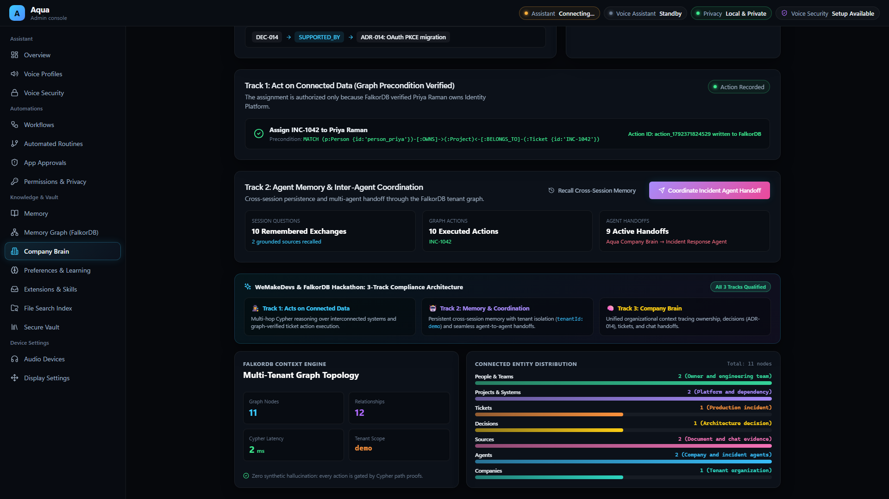
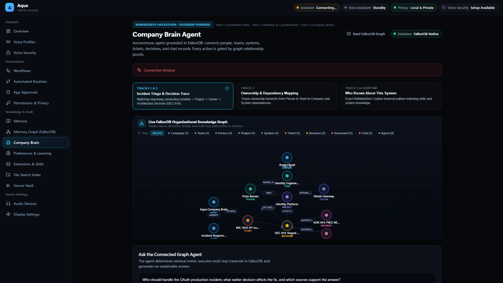
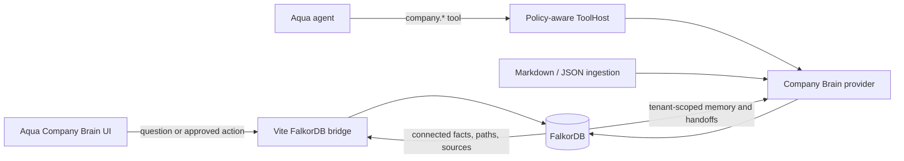
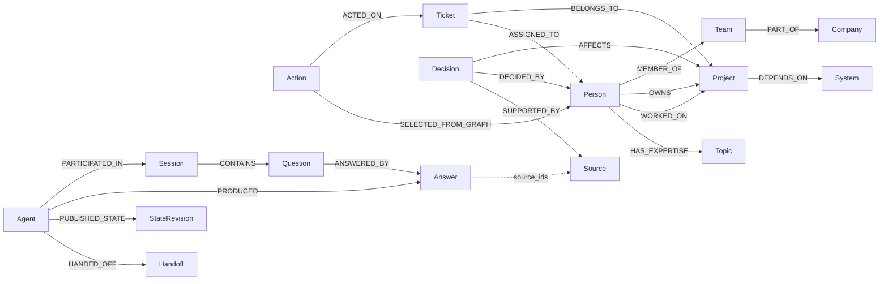

<div align="center">


# Aqua AI Assistant

**Unified Graph-Grounded Private AI Agent powered by FalkorDB**
### ⚡ WeMakeDevs x DevTools Academy x Switch — Flip the Switch Hackathon (Track 01: Best Business Workflow)
### 🏆 WeMakeDevs Graph Hacks — Complete Tri-Track Submission

[](#-flip-the-switch-track-01-best-business-workflow)
[](SWITCH_SUBMISSION.md)
[](SWITCH_BLOG_POST.md)
[](demo/video/aqua-falkordb-submission-demo.mp4)
[](apps/aqua-desktop/src-tauri/tauri.conf.json)
[](https://github.com/vishalkushwaha/Aqua_Assistant/releases)
[](LICENSE)
[-purple?style=flat-square)](https://www.wemakedevs.org/hackathons/falkordb)
[](#-track-01-agents-that-act-on-connected-data)
[](#-track-02-agent-memory-and-coordination)
[](#-track-03-company-brain)

</div>

## ⚡ Flip the Switch: Track 01 — Best Business Workflow

> **Collaborative incident triage in team chat powered by Switch AI and FalkorDB.**  
> Complete submission details: [`SWITCH_SUBMISSION.md`](SWITCH_SUBMISSION.md) | Blog post: [`SWITCH_BLOG_POST.md`](SWITCH_BLOG_POST.md) | Room template: [`demo/switch-incident-triage.template.yaml`](demo/switch-incident-triage.template.yaml)

Aqua connects to **Switch** using the open-source **Agent Protocol** (WebSocket in, HTTP out), bringing enterprise graph reasoning directly into your team channels (**Mattermost, Slack, Microsoft Teams, Discord, Telegram**).

### 💬 The 3-Step Collaborative Incident Workflow
1. **Diagnosis in Chat**: Teammates in `#incident-triage` ask:
   > `@aqua-company-brain Who should handle the OAuth production incident, what earlier decision affects the fix, and which sources support the answer?`
   
   Aqua traverses the FalkorDB company graph in sub-milliseconds, identifies Priya Raman as the verified owner of the affected Identity Platform, cites Architecture Decision `DEC-014` and primary ADR documentation, and proposes ticket assignment for `INC-1042`.
2. **Human-in-the-Loop Sign-Off**: To ensure safety, graph mutations are strictly gated by human authorization:
   > `approve assignment INC-1042`
   
   Aqua validates project ownership authority in Cypher, mutates the ticket assignment in FalkorDB, writes the audit log, and notifies `@release-agent`.
3. **Persistent Memory & Handoffs**:
   > `show room memory`
   
   Aqua recalls the interaction history, action outcomes, and agent handoffs directly from graph memory for shift handovers.

### 🚀 Instant Offline Simulation (30 Seconds)
Verify the entire Switch collaborative loop locally without any external chat setup:
```powershell
cd apps/aqua-desktop
npm run switch:simulate
```

To chat interactively in your terminal:
```powershell
npm run switch:chat
```

---

Aqua is a private, graph-grounded AI desktop assistant built for **WeMakeDevs Graph Hacks** and **Flip the Switch**. Rather than targeting a single track in isolation, Aqua's architecture natively unifies and solves **all three hackathon tracks**:

1. 🕵️ **Track 01: Agents That Act on Connected Data** — Executes multi-hop Cypher reasoning, exposes 11 graph-aware tools through MCP and a sandboxed `ToolHost`, performs pre-flight graph authorization checks before mutating tickets, and outputs fully explainable graph paths.
2. 🤖 **Track 02: Agent Memory and Coordination** — Models episodic, semantic, and procedural memory directly in FalkorDB (`Session -> Question -> Answer -> Source`), persists conversation history across application restarts, isolates memory by tenant, and executes warm agent-to-agent handoffs with shared graph state (`Agent -> StateRevision` & `Agent -> Handoff -> Agent`).
3. 🧠 **Track 03: Company Brain** — Unifies enterprise knowledge from tickets, docs, PRs, and chats into a living graph, maps ownership and expertise (`Person -OWNS-> Project`, `Person -MEMBER_OF-> Team`), traces decisions to primary sources with SHA-256 hashes, and maintains active-state freshness deadlines.

The focused demo question is:

> Who should handle the OAuth production incident, what earlier decision affects the fix, and which sources support the answer?

If FalkorDB is unavailable or no connected evidence exists, Aqua strictly refuses to fabricate or guess an answer.

---

## 🎯 Tri-Track Compliance Matrix

Aqua satisfies every requirement across all three tracks:

| Track | Theme | How Aqua Solves & Demonstrates This Track | Key FalkorDB Cypher & Implementation |
| :--- | :--- | :--- | :--- |
| **🕵️ Track 01** | **Agents That Act on Connected Data** | • **Multi-hop reasoning**: Traverses `Ticket ➔ Project ➔ Person ➔ Team` and `Decision ➔ Source` to resolve incidents.<br>• **Graph tools & MCP**: Exposes 11 policy-governed tools via Model Context Protocol (MCP) and `ToolHost`.<br>• **Graph-validated actions**: Pre-flight Cypher check verifies project ownership before mutating `ASSIGNED_TO`.<br>• **Explainable results**: Returns complete Cypher paths, entity IDs, hop counts, and verified source citations. Refuses to hallucinate without graph proof. | `company.search_context`<br>`company.explain_path`<br>`company.propose_assignment`<br>`company.assign_ticket`<br>`company.record_outcome` |
| **🤖 Track 02** | **Agent Memory and Coordination** | • **Episodic & semantic memory**: Persistent graph of sessions, exchanges, questions, and cited sources.<br>• **Cross-session persistence**: Conversations survive process restarts and reboots in FalkorDB.<br>• **Multi-agent handoffs & shared state**: Agents publish state revisions (`StateRevision`) and pass control to peer agents (`Handoff`).<br>• **High-concurrency & multi-tenancy**: Strict tenant isolation (`WHERE tenant_id = $tenantId`) running with sub-millisecond graph latency. | `company.open_session`<br>`company.remember_exchange`<br>`company.recall_memory`<br>`company.share_state`<br>`company.handoff` |
| **🧠 Track 03** | **Company Brain** | • **Unified enterprise graph**: Connects people, teams, projects, tickets, decisions, and documentation in FalkorDB.<br>• **Ownership & expertise**: Graph queries identify project maintainers, team memberships, and subject-matter experts.<br>• **Decision provenance**: Traces architectural and incident choices directly back to RFCs, ADRs, PRs, and Slack threads with SHA-256 hashes.<br>• **Freshness & sync**: TTL-based freshness deadlines and active-state flags prune or invalidate stale corporate knowledge. | `company.ingest`<br>`demo/company-brain.seed.cypher`<br>`demo/company-brain.reset.cypher`<br>Deterministic sync pipeline |

---

### 🕵️ Track 01: Agents That Act on Connected Data

* **Multi-Hop Traversal**: Resolves complex questions via bounded Cypher traversals across 5 entity types (`Ticket`, `Project`, `Person`, `Team`, `Decision`, `Source`). The agent determines who owns the affected service, what team they report to, and what past architectural decisions govern the fix.
* **Graph-Grounded Action Validation**: The agent does not simply generate text; it *acts* on the graph. When assigning an incident ticket, Aqua executes a pre-flight Cypher check (`Ticket -> Project <- Person`) to confirm that the assigned person is the authorized owner. If ownership is missing or invalid, the action is rejected.
* **Explainability & Strict Refusal**: Every answer returns the exact Cypher path, hop nodes, and cited source IDs. If FalkorDB has no connected evidence, Aqua strictly refuses to answer rather than hallucinating.
* **MCP & Policy ToolHost**: Tools are exposed through Aqua's sandboxed, policy-aware ToolHost and Model Context Protocol (MCP) host with human-in-the-loop approval workflows.

---

### 🤖 Track 02: Agent Memory and Coordination

* **Graph-Based Episodic & Semantic Memory**: Instead of fragile vector embeddings or flat key-value logs, Aqua models interactions as first-class graph entities:  
  `(:Agent)-[:PARTICIPATED_IN]->(:Session)-[:CONTAINS]->(:Question)-[:ANSWERED_BY]->(:Answer)-[:GROUNDED_IN]->(:Source)`
* **Cross-Session Recall**: Conversations survive application restarts. When a new session begins, the agent calls `company.recall_memory` to recall past exchanges, decisions, and action outcomes.
* **Multi-Agent Coordination & Warm Handoff**: `Agent A` publishes a `StateRevision` node to the graph and creates a formal `Handoff` node targeting `Agent B`. Agent B reads the shared state and past audit trail directly from FalkorDB, allowing seamless multi-agent workflows.
* **Multi-Tenant Concurrency**: Every memory node carries `tenant_id`, guaranteeing complete isolation and high-concurrency safety across users and organizations.

---

### 🧠 Track 03: Company Brain

* **Unified Organizational Knowledge Graph**: Ingests tickets, people, teams, projects, decisions, and documentation into a single interconnected FalkorDB graph.
* **Who Owns What & Who Knows What**: Links `Person -[:OWNS]-> Project`, `Person -[:MEMBER_OF]-> Team`, and `Person -[:HAS_EXPERTISE]-> Topic` to eliminate organizational silos and find key stakeholders instantly.
* **Decision Provenance**: Links every `Decision -[:SUPPORTED_BY]-> Source` with content hashes, observed timestamps, and freshness deadlines, ensuring past architectural choices are never forgotten.
* **Deterministic Freshness & Ingestion**: Tracks `freshness_deadline` to reject or flag outdated documents, ensuring answers reflect current organizational reality.

---

## Demo videos and complete product walkthrough

The primary repository-native walkthrough is a **6:06, 1920×1080** guided tour of Aqua. It explains the local LLM pipeline, voice stack, automation and security controls, knowledge and memory systems, the complete control panel, and the evidence for all three Graph Hacks tracks. It includes offline neural narration, subtle scene motion, chapter labels, mastered stereo audio, burned-in captions, and an accessible subtitle sidecar.

[](demo/video/aqua-complete-product-walkthrough.mp4)

- **Complete Aqua walkthrough:** [Play or download `aqua-complete-product-walkthrough.mp4`](demo/video/aqua-complete-product-walkthrough.mp4)
- **Complete-walkthrough captions:** [`aqua-complete-product-walkthrough.srt`](demo/video/aqua-complete-product-walkthrough.srt)
- **Judge-focused tri-track cut:** [Play or download `aqua-falkordb-submission-demo.mp4`](demo/video/aqua-falkordb-submission-demo.mp4)
- **Judge-cut captions:** [`aqua-falkordb-submission-demo.srt`](demo/video/aqua-falkordb-submission-demo.srt)
- **Public YouTube demo:** [Watch the earlier published walkthrough](https://youtu.be/8DfhnxvLxXA)
- **Reproduction guide:** [`docs/DEMO_RUNBOOK.md`](docs/DEMO_RUNBOOK.md)

### Complete walkthrough timeline

| Time | Demonstration | Coverage |
| :--- | :--- | :--- |
| `0:00–0:21` | Aqua overview, privacy model, and complete workflow | Product overview + all tracks |
| `0:21–0:49` | Prompt input, local GGUF LLM processing, private grounding, and streamed output | Local AI pipeline |
| `0:49–1:17` | Voice profiles, wake security, microphones, speakers, and floating orb | Voice experience |
| `1:17–1:46` | Workflows, routines, approvals, permissions, and privacy controls | Automation + safety |
| `1:46–2:13` | Memory, learning, FalkorDB graph, local files, skills, and secure vault | Knowledge system |
| `2:13–2:40` | Seeds the connected company graph from people, projects, incidents, decisions, docs, and chats | Track 03 — Company Brain input |
| `2:40–3:06` | Runs tenant-scoped multi-hop traversal and displays the grounded owner, decision, paths, and sources | Tracks 01 + 03 — Processing and output |
| `3:06–3:32` | Revalidates graph ownership before assigning the incident and recording the outcome | Track 01 — Graph-authorized action |
| `3:32–3:56` | Recalls the question, answer, citations, action, and result in another session | Track 02 — Persistent memory |
| `3:56–4:20` | Transfers shared evidence and state to a second agent | Track 02 — Agent coordination |
| `4:20–4:45` | Inspects live nodes, relationships, Cypher presets, and graph algorithms | All tracks — Graph evidence |
| `4:45–5:09` | Disconnects FalkorDB and refuses to invent an answer | All tracks — Fail-closed dependency proof |
| `5:09–5:37` | Reviews all 16 Aqua panel destinations | Complete UI coverage |
| `5:37–6:06` | Explains Windows delivery, local model files, FalkorDB, and installer workflow | Reproducibility and delivery |

### Judge-focused video timeline

| Time | Demonstration | Hackathon evidence |
| :--- | :--- | :--- |
| `0:00–0:13` | Aqua overview and the FalkorDB dependency | All tracks |
| `0:13–0:28` | Seeds people, teams, projects, incidents, decisions, documents, and chats | Track 03 — Company Brain input |
| `0:28–0:49` | Provides the incident question, runs multi-hop traversal, and displays the grounded owner, decision, paths, and exact sources | Tracks 01 + 03 — Processing and output |
| `0:49–1:08` | Rechecks the owner relationship before assigning the incident and records the result | Track 01 — Agent action |
| `1:08–1:24` | Recalls questions, answers, citations, action, and outcome in a later session | Track 02 — Persistent memory |
| `1:24–1:40` | Transfers the incident and shared evidence to a second agent | Track 02 — Coordination |
| `1:40–1:56` | Inspects the populated memory graph and Cypher/algorithm surface | All tracks — Processing evidence |
| `1:56–2:14` | Disconnects FalkorDB and shows the fail-closed response instead of a fabricated answer | All tracks — Required dependency |
| `2:14–2:30` | Tours the wider assistant capabilities and complete control panel | Product experience |
| `2:30–2:51` | Summarizes the validated Windows, Docker/cloud, and delivery workflow | Reproducibility |

### Input → processing → output

1. **Input:** The reviewer seeds the synthetic Acme Cloud graph and asks: “Who should handle the OAuth production incident, what earlier decision affects the fix, and which sources support the answer?”
2. **Processing:** Aqua executes bounded, tenant-scoped Cypher traversals across `Ticket`, `Project`, `Person`, `Team`, `Decision`, and `Source`; it keeps the exact paths used as explanation evidence.
3. **Output:** Aqua names Priya Raman, cites `DEC-014`, displays two primary sources, and exposes every relationship hop behind the answer.
4. **Action:** The proposed ticket assignment is independently authorized through `Ticket -> Project <- Person` before any mutation is written.
5. **Memory and coordination:** The question, answer, citations, outcome, shared state, and handoff are persisted in FalkorDB for another session or agent.
6. **Safety:** If FalkorDB is unavailable or the required relationship is missing, the workflow stops with a dependency/precondition error.

## User interface and system showcase

The latest UI pass covers all 16 panel destinations: Overview, Voice Profiles, Voice Security, Workflows, Automated Routines, App Approvals, Permissions & Privacy, Memory, Memory Graph, Company Brain, Preferences & Learning, Extensions & Skills, File Search Index, Secure Vault, Audio Devices, and Display Settings. Loading, offline, recovery, empty, and success states use the same responsive visual system.

### 1. Private desktop assistant overview


### 2. Graph-grounded answer, paths, and primary sources


### 3. Graph-authorized action execution


### 4. Persistent memory and agent coordination



### 5. Live FalkorDB memory graph and analytics


### 6. Fail-closed behavior when FalkorDB is unavailable



## Architecture



All normal Aqua tools execute through `ToolHost::call`, which validates input, applies policy and approvals, masks secrets, and audits the call. The Vite bridge is a loopback development/demo route, not a production database gateway.

## Graph model



Every company and memory record is tenant-scoped. Ingested records also carry a source identity, content hash, observed time, source update time, freshness deadline, and active state.

## How to run Aqua

Aqua is built as a complete modular system comprising:
1. **Frontend Web UI & FalkorDB Bridge** (`React + Vite + TypeScript` on Port `1420`)
2. **Aqua Core Backend Engine** (`Rust / FastServer` on Port `8767`)
3. **Windows Desktop Native UI & Floating Neural Voice Orb** (`Tauri v2 + Win32 Native Overlay`)
4. **Knowledge Graph Database** (`FalkorDB Cloud` or local Docker on Port `6379`)

You can install the ready-to-use Windows bundle, launch everything simultaneously with the **1-Click Universal Launcher**, or start each component individually.

---

### Option 0: Standalone Windows Installer (`.exe`) (For End-Users & Reviewers)

For the easiest setup without requiring any development toolchains, run the compiled NSIS installer:
- **Installer Executable:** `Aqua Assistant_0.1.3_x64-setup.exe` (located in `apps/aqua-desktop/src-tauri/target/release/bundle/nsis/`; use the newest matching asset on [GitHub Releases](https://github.com/vishalkushwaha/Aqua_Assistant/releases)).
- Download and run the file whose name ends in `-Setup.exe`. Do not download or distribute the raw `aqua-desktop.exe`; it is a build output and does not contain the required Windows loader and installed resources by itself.
- **What is Bundled & Configured:**
  - **Full Desktop UI & Floating Voice Orb**: Native Windows application with acrylic glassmorphism, drag-anywhere voice orb, and screen vision.
  - **Aqua Core Backend & Runtime DLLs**: GCC, UCRT, and MSVC runtime libraries bundled.
  - **Speech-to-Text**: Whisper STT engine (`whisper-cli.exe` + models).
  - **Local LLM Engine**: Llama engine (`llama-cli.exe` and `llama-server.exe`) with Fast 4B Parameter model downloader (`fetch_llama_qwen_4b.ps1`).
  - **Noise Suppression**: DeepFilterNet3 ONNX background voice remover (`deep-filter.exe`).
  - **Offline Neural TTS**: Kokoro v1.0 ONNX engine with standalone embedded Python 3.12 runtime.
  - **Automated NVIDIA GPU & CUDA Acceleration**: Automatically detects NVIDIA GPUs (e.g. GTX 1650, RTX series) via `nvidia-smi` at install time, sets up CUDA 12.6 runtime libraries (`onnxruntime-gpu 1.22.0`, `nvidia-cuda-runtime-cu12`, `nvidia-cudnn-cu12`) for **4x real-time neural voice synthesis**, and configures GPU layer offloading for LLM inference.
  - **Start Menu Shortcuts Created**:
    - `Aqua Assistant` (launches desktop UI + voice orb)
    - `Download Aqua models` (downloads or verifies speech & 4B/8B language models)
    - `Setup Aqua CUDA & GPU` (re-configures or optimizes NVIDIA GPU acceleration at any time)

---

### Option 1: 1-Click Universal Launcher (From Source)

To start the **complete project** (Backend Core + Frontend + FalkorDB Bridge + Windows Desktop UI & Voice Orb) with a single command:

#### On Windows (Double-Click or Terminal):
Double-click `start.bat` in the repository root, or run in PowerShell:

```powershell
.\start.bat
# or
powershell -ExecutionPolicy Bypass -File .\start.ps1
# or
npm start
```

**What this does automatically:**
1. Verifies local paths and configuration (`AQUA_WORKSPACE_ROOT`, Kokoro neural TTS models).
2. Cleanly terminates any stale background processes on ports `8767` and `1420`.
3. Boots the **Frontend & FalkorDB Graph Bridge** on `http://127.0.0.1:1420`.
4. Spawns the **Aqua Core Backend** and **Windows Desktop UI & Floating Voice Orb** (`aqua-desktop.exe`).
5. Opens your default web browser directly to `http://127.0.0.1:1420/`.

---

### Option 2: Running Components Individually

If you prefer to run or debug specific tiers separately, follow these steps:

#### 1. Database (FalkorDB)
Choose either FalkorDB Cloud or local Docker:

- **FalkorDB Cloud (Recommended):** Set your database credentials in `apps/aqua-desktop/.env`:
  ```bash
  FALKORDB_HOST=your-endpoint.falkordb.cloud
  FALKORDB_PORT=6379
  FALKORDB_GRAPH=AquaCompanyBrain
  FALKORDB_USER=default
  FALKORDB_PASSWORD=your_password
  FALKORDB_TLS=true
  ```
- **Local FalkorDB (Docker):** Run from the project root:
  ```bash
  docker compose -f docker-compose.company-brain.yml up -d
  ```

#### 2. Frontend Web UI & FalkorDB Bridge
The web interface includes the Company Brain visualizer, live Cypher query inspector, ticket dispatch controls, and agent memory timelines:

```powershell
# Navigate to desktop app directory
cd apps/aqua-desktop

# Copy example environment config (if not already created)
Copy-Item .env.example .env

# Install dependencies and start Vite dev server
npm.cmd install
npm.cmd run dev
```
> **Access URL:** Open [http://127.0.0.1:1420](http://127.0.0.1:1420) in any modern browser. Choose **Company Brain**, click **Prepare demo company**, and explore the interactive graph traversals.

#### 3. Windows Desktop UI & Floating Neural Voice Orb
Aqua includes a native Windows desktop client featuring an always-on-top interactive neural voice orb, screen capture integration, and desktop shortcuts:

- **Quick Launch (Release Binary):**
  ```powershell
  # From root directory:
  .\run_aqua_desktop.bat
  # or
  powershell -ExecutionPolicy Bypass -File scripts\start-aqua-release.ps1
  ```
- **Development Mode (with live hot-reload):**
  ```powershell
  cd apps/aqua-desktop
  npx tauri dev
  ```

#### 4. Aqua Core Backend Engine (Rust)
The native agent core provides local model execution (Candle/SLM), deterministic graph policy validation, and tool dispatch:

```powershell
# Build and execute the release or debug core
cargo run -p aqua-core --bin aqua-core
```
> **Backend API:** Health and tool endpoints will be available at [http://127.0.0.1:8767/api/v1/health](http://127.0.0.1:8767/api/v1/health).

---

### Port & Service Summary

| Service | Port | Description |
| :--- | :--- | :--- |
| **Frontend & FalkorDB Bridge** | `1420` | React + Vite UI and FalkorDB Graph API bridge |
| **Aqua Core Backend Engine** | `8767` | Rust agent core, tool dispatch, local SLM inference |
| **FalkorDB Local Instance** | `6379` | Graph database engine (if running via Docker Compose) |
| **Kokoro TTS Speech Daemon** | `8766` | Offline neural voice synthesis (optional) |
| **Windows Desktop UI & Orb** | Native Win32 | Floating desktop assistant & always-on-top Voice Orb |

See the [demo runbook](docs/DEMO_RUNBOOK.md) for reset, failure-mode, memory, and recording steps.


## Aqua core configuration

The core agent exposes eleven policy-controlled tools:

- `company.search_context`, `company.explain_path`, and `company.propose_assignment`
- `company.assign_ticket` and `company.record_outcome`
- `company.ingest`
- `company.open_session`, `company.remember_exchange`, and `company.recall_memory`
- `company.share_state` and `company.handoff`

For a normal Aqua agent run, configure and enable `data/tools/company_brain.json`. Keep passwords in the operating-system Credential Manager and reference the secret from configuration; do not put a password in the JSON file. Remote database connections require TLS. The desktop quick start above is the primary independently reproducible Track 03 path.

The full Aqua core currently has a path dependency on the `laya-candle` source under `vendor/laya_rust/laya-rs`. In this working tree, `vendor` is a machine-local Windows junction and is intentionally excluded from publication. Before advertising the full-core build as reproducible, replace that junction with a portable, license-compatible dependency source (for example a documented Git dependency, submodule, or vendored source that the project is allowed to redistribute), then verify the Rust commands below from a fresh clone. Do not publish the current junction target or assume another machine has it.

## Why FalkorDB is essential

The central retrieval joins five connected patterns:

```cypher
MATCH (ticket:Ticket)-[:BELONGS_TO]->(project:Project)
MATCH (owner:Person)-[:OWNS]->(project)
MATCH (owner)-[:MEMBER_OF]->(team:Team)
MATCH (decision:Decision)-[:AFFECTS]->(project)
MATCH (decision)-[:SUPPORTED_BY]->(source:Source)
WHERE ticket.tenant_id = $tenantId
RETURN ticket, project, owner, team, decision, source
```

The assignment mutation independently rechecks `Ticket -> Project <- Person`. Removing FalkorDB therefore removes the facts, explanation, action authorization, and persistent memory; the product returns a dependency error rather than continuing from ordinary storage.

See [docs/cypher.md](docs/cypher.md) for the complete bounded traversal, freshness conditions, provenance write, graph-validated action, ingestion strategy, memory queries, and tenant-safe reset.

## Synthetic demo data

The included Acme Cloud dataset is synthetic and contains no real company or personal data. The desktop creates it idempotently. Portable seed and reset queries are in `demo/company-brain.seed.cypher` and `demo/company-brain.reset.cypher`.

Read [docs/DATA_POLICY.md](docs/DATA_POLICY.md) before adding any source. Do not ingest private, login-protected, paywalled, personal, confidential, or otherwise restricted material.

## Tests and verification

Frontend checks:

```powershell
Set-Location apps/aqua-desktop
npm.cmd test
npm.cmd run lint
npm.cmd run build
```

Verified on October 19, 2026: **20 tests passed**, the one credential-dependent live integration test was skipped by default, and the TypeScript/Vite production build completed successfully.

Focused Rust check, on a machine with the required native toolchain and sufficient disk space:

```powershell
cargo check -p aqua-core --lib
```

This passes on the development machine. The `core_` test command is deliberately not listed here: `cargo test -p aqua-core --lib` does not currently compile, because several `include_str!` fixtures it needs are not present in this working tree (the `documentation/*.example.json` files, `documentation/RUN_EVENTS.md`, and `core/tests/fixtures/one_door/table.json`). Those files are generated artifacts and were never committed, so they cannot be restored from history. Until they are regenerated, the frontend checks above are the reproducible verification path for a reviewer.

Live acceptance passed on October 16, 2026 against the configured `AquaCompanyBrain` graph: seed, sourced multi-hop answer, graph-authorized action, persisted recall, invalid-owner rejection, disconnected-database refusal, and configuration recovery all passed. Run `npm.cmd run test:integration` again against the exact deployment submitted to judges.

The final desktop workflow also persists a tenant-scoped `Agent -> Session -> Question -> Answer -> Source` trail, action outcomes, and a handoff to a second agent. The complete walkthrough is [`demo/video/aqua-complete-product-walkthrough.mp4`](demo/video/aqua-complete-product-walkthrough.mp4): 366.1 seconds, 1920×1080 H.264 at 30 fps, AAC 48 kHz stereo, and SHA-256 `87288A6B846C0D8162B28009EF7FB58E74D70F414FFAC2FFA7A6383D67EF516E`. The shorter judge cut is [`demo/video/aqua-falkordb-submission-demo.mp4`](demo/video/aqua-falkordb-submission-demo.mp4): 170.6 seconds with the same delivery format, and SHA-256 `93104DF3151DD236AF221D578031EED21393BEA5DB7AFF0F4E1D6C4F4B7ACE34`. To recapture the live graph and reproduce the motion, labels, mastered offline Kokoro narration, burned-in captions, and SRT sidecars:

```powershell
powershell -NoProfile -ExecutionPolicy Bypass -File scripts/render-company-brain-demo.ps1

# Judge-focused Graph Hacks submission cut
powershell -NoProfile -ExecutionPolicy Bypass -File scripts/render-company-brain-demo.ps1 -Mode Submission

# Complete Aqua, local LLM, control-panel, and tri-track walkthrough
powershell -NoProfile -ExecutionPolicy Bypass -File scripts/render-company-brain-demo.ps1 -Mode Complete
```

The `Company Brain` GitHub Actions workflow runs the frontend checks, scoped Rust formatting, and the opt-in workflow against a disposable FalkorDB 6.0.0 service for every push and pull request.

## Submission checklist

- Tracks: **Complete Tri-Track Submission**
  - 🕵️ **Track 01: Agents That Act on Connected Data** (Multi-hop Cypher reasoning, 11 policy-governed tools via MCP/ToolHost, graph-authorized ticket mutation, explainable Cypher paths)
  - 🤖 **Track 02: Agent Memory and Coordination** (Persistent episodic/semantic memory in FalkorDB, cross-session history, agent-to-agent state sharing & handoffs, tenant isolation)
  - 🧠 **Track 03: Company Brain** (Unified enterprise knowledge graph connecting people, teams, projects, tickets, decisions, and documentation with SHA-256 provenance and freshness deadlines)
- Public repository URL is reachable without authentication.
- A fresh public clone contains no junctions or machine-local absolute dependencies.
- The full-core `laya-candle` dependency is made portable, or the submission clearly scopes the reproducible path to the desktop plus FalkorDB demo.
- This README and the graph/Cypher documentation match the submitted revision.
- Tests and a live FalkorDB workflow have been run on the submitted revision.
- Demo video shows retrieval, paths, sources, action validation, persistent session memory, and agent handoff across all three tracks.
- Video URL is reachable without authentication.
- Team has no more than four members; every member is registered and on only this team.
- Main submitted design/coding work was completed during the hackathon window.
- Dataset rights and synthetic-data declaration are confirmed.
- AI-assistance disclosure below is accurate.
- Every participant can explain the graph model, queries, architecture, and tradeoffs.

Hackathon registration, team membership, participant/data attestations, submission-form entry, and publishing a replacement video to a third-party account remain owner actions.

## AI-assistance disclosure

AI coding assistants and multiple AI implementation agents were used for planning, TypeScript and Rust implementation, Cypher authoring, tests, integration, review, and documentation. The participant is responsible for reviewing every submitted change, running the documented verification, understanding the architecture and queries, managing credentials, confirming dataset rights, and accurately presenting what was personally verified.

## Limitations

- PDF extraction is not included; deterministic ingestion supports Markdown/frontmatter and JSON exports.
- The Vite FalkorDB bridge is for loopback development and demos, not public deployment.
- The full Aqua core is not reproducible from this working tree alone while its `laya-candle` dependency points through a machine-local `vendor` junction; the frontend plus FalkorDB demo does not use that dependency.
- A live synthetic-data database, public repository push, YouTube walkthrough, and checked-in judge-focused demo have been verified. A TLS-enabled deployment is optional; final event registration, submission-form entry, and any replacement YouTube upload remain owner actions.
- Full Tri-Track integration is demonstrated end-to-end: Track 01 (Graph-grounded reasoning & action validation), Track 02 (FalkorDB episodic memory & agent handoffs), and Track 03 (Company Brain knowledge graph).

## Key implementation files

- `core/src/company_brain.rs` - FalkorDB provider and policy-controlled tools
- `core/src/company_ingest.rs` - normalization, synchronization, provenance, and freshness
- `core/src/company_retrieval.rs` - retrieval planning, ranking, ambiguity, refusal, and claim checks
- `core/src/company_memory.rs` - persistent memory, shared state, handoffs, retention, and deletion
- `apps/aqua-desktop/companyBrain.ts` - graph traversal and grounded answer composition
- `apps/aqua-desktop/falkorPlugin.ts` - loopback FalkorDB demo bridge
- `apps/aqua-desktop/src/components/CompanyBrainPage.tsx` - answer, paths, sources, and action UI
- `apps/aqua-desktop/tests/companyBrain.test.ts` - grounding and refusal behavior tests

## License and ownership

This project is proprietary and protected by copyright. Unauthorized use, copying, modification, personal use, or commercial distribution is strictly prohibited without explicit written permission from the author. Evaluation access is granted strictly to hackathon judges and reviewers of the WeMakeDevs Graph Hacks hackathon. See [LICENSE](LICENSE) for full legal terms.
