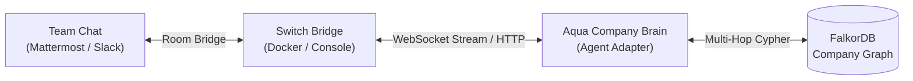

# Turning an AI Agent into a Teammate: Building Aqua Company Brain with Switch

> *Submitted for the **Flip the Switch Hackathon** (Track 01: Best Business Workflow & Best Blog) by WeMakeDevs x DevTools Academy x Switch.*  
> *#HowISwitch #WeMakeDevs #DevToolsAcademy*

---

## The Solitary Agent Problem

Over the past year, AI coding assistants have completely transformed developer workflows. Whether you use Claude Code, Codex, Cursor, or local agents, they all share one critical limitation: **they are solitary tools running in isolation on your laptop terminal.**

Meanwhile, in real engineering organizations, software engineering is a team sport. When a production outage hits at 09:42 AM:
- Incident response doesn't happen in an isolated terminal; it happens in **team chat** (`#incidents` on Slack, Discord, or Mattermost).
- Context is scattered across Jira tickets, GitHub PRs, team rosters, and historical Architecture Decision Records (ADRs).
- Junior on-call engineers spend critical minutes asking: *"Who actually owns this service? Has anyone migrated this before? What past decision affects our fix?"*

We asked ourselves: **What if we could take our graph-grounded agent, Aqua, and put it directly into our team chat channels as an active, reliable teammate?**

That is where [Switch](https://www.wemakedevs.org/hackathons/switch) comes in.

---

## Enter Switch: Open-Source Infrastructure for Team AI

Switch provides the missing bridge between AI agents and team chat apps. Instead of writing separate bot integrations for Slack, Microsoft Teams, Discord, and Mattermost, Switch provides a universal **Agent Protocol**:

* **Server-Sent Events / WebSocket in**: Real-time room events and messages delivered straight to your agent.
* **HTTP REST out**: Standardized endpoints for agents to post messages, update cards, and report actions.
* **Rooms as Shared State**: Every chat channel becomes a room where people and AI agents read instructions, collaborate on tasks, and maintain persistent state.

With Switch, we didn't have to build another chatbot from scratch. We simply hooked up our existing knowledge graph engine into Switch's agent loop.

---

## Architecture: How Aqua and Switch Work Together



Our agent, **Aqua Company Brain**, is powered by **FalkorDB**. It doesn't use fuzzy vector search or guess answers. It maps the company as a living graph:
$$\text{Ticket (INC-1042)} \longrightarrow \text{Project (Identity Platform)} \longleftarrow \text{Person (Priya Raman)} \longrightarrow \text{Team (Identity)}$$
$$\text{Decision (DEC-014)} \longrightarrow \text{Project} \longrightarrow \text{Source Document (ADR-014)}$$

When a teammate tags `@aqua-company-brain` in a Switch room, Aqua traces the exact multi-hop relationship paths and returns verified facts with primary sources.

---

## The 3-Step Collaborative Incident Workflow

Here is how a real incident gets diagnosed, approved, and handed off right inside team chat:

### 1. Incident Diagnosis in Chat
An on-call engineer notices 500 errors on the checkout service and asks in the room:

> **Sam**: `@aqua-company-brain Who should handle the OAuth production incident, what earlier decision affects the fix, and which sources support the answer?`

Within sub-milliseconds, Aqua executes bounded Cypher queries in FalkorDB and replies:

> **Aqua Company Brain**:  
> Priya Raman (Staff Engineer, Identity Engineering) owns the Identity Platform and should handle the OAuth production incident. Earlier decision DEC-014 (*Use staged PKCE migration*) affects the fix.  
>  
> **Evidence paths**:  
> • `INC-1042` → `BELONGS_TO` → `Identity Platform` → `OWNS` → `Priya Raman`  
> • `DEC-014` → `AFFECTS` → `Identity Platform` → `SUPPORTED_BY` → `SRC-ADR-014`  
>  
> **Sources**:  
> • `SRC-ADR-014`: ADR-014: OAuth PKCE migration (`company://docs/ADR-014`)  
>  
> **Proposed action**: Assign `INC-1042` to Priya Raman. Reply `approve assignment INC-1042` within 15 minutes to execute it, or `cancel assignment`.

---

### 2. Human-in-the-Loop Sign-Off
Autonomous agents that mutate infrastructure or ticket states without human approval are dangerous. In Aqua, **actions require human authorization**:

> **Sam**: `approve assignment INC-1042`

Aqua captures the approval, performs a pre-flight Cypher check to re-verify Priya's ownership authority, mutates the ticket assignment in FalkorDB, writes the audit log, and notifies the team:

> **Aqua Company Brain**:  
> Assignment completed: `INC-1042` was assigned to Priya Raman after explicit approval in Switch. Action `ACT-9042`. Handoff `HANDOFF-101` is stored in the graph. `@release-agent`

---

### 3. Shared Room Memory & Handoffs
Later in the shift, another engineer joins the room:

> **Priya**: `show room memory`

> **Aqua Company Brain**:  
> **Recent grounded answers**:  
> • Q: Who should handle the OAuth production incident?  
>   A: Priya Raman owns Identity Platform...  
>  
> **Actions**:  
> • `assign_ticket`: `INC-1042` (`completed`)  
>  
> **Handoffs**:  
> • `aqua-company-brain` → `release-agent`: `INC-1042` was assigned to Priya Raman after explicit approval in Switch.

Because sessions are persistent, any teammate or peer agent can immediately review the exact audit trail without sifting through hundreds of chat messages.

---

## What We Learned Building with Switch

1. **Reconnection & Cursor Management**: In real chat environments, network interruptions happen. Switch's protocol includes cursor and generation checkpoints. We built [SwitchWorkflowState](apps/aqua-desktop/switch/workflowState.ts) to store checkpoints and maintain a sliding deduplication window so messages are never processed twice.
2. **Time-Bounded Approvals**: In high-velocity triage rooms, stale proposals can be dangerous. We enforced a strict 15-minute expiration window for pending proposals.
3. **Fail-Closed Dependability**: If the database is disconnected or no connected path exists, Aqua explicitly replies: *"I could not find connected, current evidence in FalkorDB, so I will not guess."* An agent that admits what it doesn't know is infinitely more trustworthy than one that hallucinates.

---

## How to Try It Out

We built an offline, zero-dependency simulation so anyone can test the entire workflow in seconds:

```powershell
git clone https://github.com/vishalkushwaha/Aqua_Assistant.git
cd Aqua_Assistant/apps/aqua-desktop
npm install
npm run switch:simulate
```

Or connect it live to your Switch Console by running:
```cmd
run_switch_agent.bat
```

Switch allowed us to turn a solo desktop agent into a collaborative teammate in our team chat. We can't wait to see more developers flip the switch!
