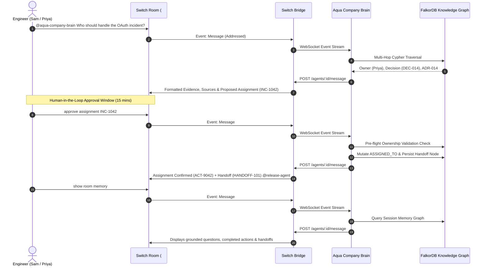

# Flip the Switch Hackathon Submission: Aqua Company Brain

> **Event**: Flip the Switch Hackathon (WeMakeDevs x DevTools Academy x Switch)  
> **Dates**: November 4–7, 2026  
> **Track**: **Track 01: Best Business Workflow ($2,000 in cash)**  
> **Side Tracks**: **Best Blog** (AirPods 5) & **Code with Wispr** ($500)  

---

## 1. Basic Information
* **Project Name**: Aqua Company Brain
* **Tagline**: Collaborative incident triage in team chat — connecting an enterprise graph AI agent to Slack, Teams, Discord, and Mattermost via Switch.
* **Track Selected**: **Track 01: Best Business Workflow**
* **Repository URL**: `https://github.com/vishalkushwaha/Aqua_Assistant`
* **Switch Room Template**: [`demo/switch-incident-triage.template.yaml`](demo/switch-incident-triage.template.yaml)
* **Demo Video URL**: *(Paste your 2-3 minute YouTube or Loom walkthrough link here)*
* **Blog Post URL**: *(Link to SWITCH_BLOG_POST.md published on Hashnode/Dev.to)*

---

## 2. Elevator Pitch
**Aqua Company Brain turns your team chat into an intelligent, graph-authorized incident operations room using Switch.** When an outage strikes, teammates tag `@aqua-company-brain` in Slack or Mattermost. Instead of guessing or searching flat docs, Aqua traverses a connected enterprise graph in FalkorDB (`Incident ➔ Project ➔ Owner ➔ Team ➔ Architectural Decisions ➔ Source ADRs`), returns verified ownership and historical decision context, and proposes ticket assignments. Crucially, Aqua **enforces human-in-the-loop authorization**: the ticket is only mutated after an explicit teammate sign-off (`approve assignment INC-1042`), recording the audit log and passing a warm handoff to peer agents right inside the chat room.

---

## 3. How Switch is Central to the Project
Switch is the central nervous system that enables Aqua to work alongside real engineers in everyday chat:

* **Open-Source Agent Protocol**: Aqua connects to Switch using the bidirectional Agent Protocol (**WebSocket/SSE stream in, authenticated HTTP out**), enabling always-on room presence without maintaining proprietary chat bots for each platform.
* **Universal Chat Bridge**: Through Switch, Aqua seamlessly joins channels in **Mattermost (local zero-config), Slack, Microsoft Teams, Discord, and Telegram**.
* **Shared Room State & Teammate Continuity**: Switch rooms serve as the shared collaborative log where engineers and AI agents read instructions, ask questions, approve critical actions, and inspect persistent memory.
* **Without Switch**: Aqua would remain an isolated, single-user desktop application. Switch elevates Aqua into a 24/7 autonomous teammate that interacts with the entire engineering organization.

---

## 4. The Business Workflow Demonstrated

### Context: The Acme Cloud OAuth Production Incident
When an outage occurs on the checkout service, engineers need instant, reliable answers to three critical questions:
1. *Who is the authorized owner responsible for this service?*
2. *What past architectural decision affects the fix?*
3. *Which primary sources and documentation support this resolution?*

### The 3-Step Collaborative Loop



---

## 5. Technical Architecture

* **Switch Bridge & Protocol**: [`apps/aqua-desktop/switch/switchClient.ts`](apps/aqua-desktop/switch/switchClient.ts)
  * Implements reconnecting WebSocket listener for Switch room events.
  * Handles control frames (`gap`, `evicted`, `refused`).
  * Manages checkpointing and cursor resumption.
* **Workflow Engine**: [`apps/aqua-desktop/switch/companyBrainWorkflow.ts`](apps/aqua-desktop/switch/companyBrainWorkflow.ts)
  * Strips mentions, enforces 15-minute approval deadlines, and coordinates incident ticket mutations.
* **State Manager**: [`apps/aqua-desktop/switch/workflowState.ts`](apps/aqua-desktop/switch/workflowState.ts)
  * Deduplicates message IDs to prevent double execution during network reconnects.
  * Maintains pending ticket assignment states per room.
* **Knowledge Layer**: FalkorDB
  * Models company people, teams, projects, tickets, decisions, and documentation.
  * Strict fail-closed policy: If no connected evidence exists, refuses to hallucinate.

---

## 6. How to Run & Reproduce

### Option A: Zero-Dependency Offline Simulation (30 seconds)
```powershell
cd apps/aqua-desktop
npm run switch:simulate
```
*Spawns an in-process mock Switch bridge and executes the entire 3-step conversation, verifying 100% test pass rate.*

### Option B: Live Switch Console & Mattermost
1. Start Switch Console (with bundled Mattermost).
2. Configure `.env` in `apps/aqua-desktop`:
   ```env
   SWITCH_BRIDGE_URL=http://127.0.0.1:8080
   SWITCH_REGISTRATION_TOKEN=your_token
   SWITCH_ROOM_IDS=incident-triage
   ```
3. Run the agent listener:
   ```cmd
   run_switch_agent.bat
   ```
4. In Switch Console or Mattermost `#incident-triage`, chat with `@aqua-company-brain`.
