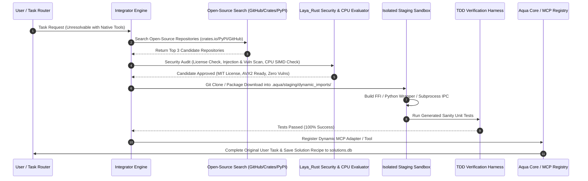

# Aqua Autonomous Open-Source Dependency Discovery & Auto-Integration Engine (`core/src/modules/dependency_integrator/`)

> **Code status (2026-10-08): written, not wired.** `AutoIntegrator` has tests, and nothing outside them calls it ([who calls what](../../../../documentation/competitive/refresh/10_DEAD_CODE_CALLERS.md)). The text below describes the design, not what runs in Aqua. It returns a fixed list of packages. Register: `sim.dependency_integrator` (simulated).

---

## 1. Executive Summary & Purpose

When Aqua receives a complex user request that requires capabilities not currently built into the core system or installed MCP adapters (e.g., extracting audio from a niche video format, parsing a specialized medical DICOM file, or interfacing with a unique hardware protocol), the **Autonomous Dependency Integrator** takes over.

Rather than failing or stating "capability unsupported", Aqua automatically:
1. **Identifies Missing Capability Requirements**: Detects the missing feature, file format parser, or API wrapper required to fulfill the user prompt.
2. **Searches Open-Source Repositories**: Searches package registries (`crates.io`, `PyPI`, `npm`, `GitHub`, `HuggingFace`) using natural language & technical intent mapping.
3. **Safety & Hardware Compatibility Audit**: Evaluates candidate libraries for license compatibility (MIT, Apache-2.0, BSD), security vulnerabilities, and 100% CPU compatibility (AVX2/INT8 SIMD, zero mandatory GPU requirement).
4. **Sandboxed Pull & Compilation**: Downloads source code into `.aqua/staging/dynamic_imports/`, compiles native Rust FFI bindings, C++ wrappers, or isolated Python/Node subprocesses.
5. **TDD Harness & Verification**: Generates synthetic test fixtures to verify the imported library successfully solves the target problem without memory leaks or side effects.
6. **Dynamic Tool / MCP Registration**: Exposes the newly integrated capability as a dynamic internal MCP tool or native plugin so it can be re-used across future tasks.
7. **Task Execution**: Seamlessly executes the original user task and presents the verified result to the user.

---

## 2. Architectural Pipeline & Sequence

---

## 3. Subsystem Components & Responsibilities

### 3.1 Capability Gap Analyzer (`gap_analyzer.rs`)
- Triggered when `Laya_Rust` or the LLM Task Router returns a `MISSING_CAPABILITY` status.
- Formulates target search query strings, required input/output types, and target execution runtime (Rust crate, Python package, C/C++ lib, or CLI utility).

### 3.2 Open-Source Search Adapter (`registry_search.rs`)
- Queries public registries and APIs:
  - **Rust**: `crates.io/api/v1/crates`
  - **Python**: `pypi.org/pypi/<pkg>/json`
  - **JavaScript**: `registry.npmjs.org`
  - **GitHub / Code**: GitHub Search API / web scraping fallback.
- Filters results by star rating, maintenance activity, download count, and license type.

### 3.3 Security, License & CPU Evaluator (`evaluator.rs`)
- **License Compliance Firewall**: Rejects GPL/AGPL (copyleft) packages if they contaminate core closed/permissive licensing; allows MIT, Apache 2.0, BSD-2/3, MPL.
- **CPU SIMD Vectorization Audit**: Verifies candidate binary/library compiles cleanly for x86_64 AVX2 / ARM64 NEON without requiring CUDA or fixed GPU drivers.
- **Static Code Analysis**: Runs `Laya_Rust` static parser on pulled source code to detect network phone-home hooks, unverified socket calls, or disk wiping calls (`rm -rf`, raw system calls).

### 3.4 Isolated Staging Sandbox (`sandbox.rs`)
- Operates inside `.aqua/staging/dynamic_imports/<pkg_id>/`.
- Sandboxed execution using OS-level process isolation (Windows Job Objects / AppContainer, Linux cgroups/chroot, macOS sandbox-exec).
- Compiles Rust FFI crates into dynamic shared objects (`.dll`, `.so`, `.dylib`) or creates an isolated Python venv (`.aqua/venvs/<pkg_id>/`).

### 3.5 TDD Verification & Solution Recipe Logger (`verification.rs`)
- Synthesizes input fixtures matching the user's task.
- Executes the compiled wrapper in sandbox and checks exit codes, output schemas, and RAM consumption (<50MB delta).
- On success, registers the new module into `solutions.db` and `.aqua/plugins/dynamic_tools.json` so Aqua never has to re-fetch the dependency for future tasks.

---

## 4. Universal Fallback & Rollback Rules

- **Zero Contamination**: If the candidate open-source library fails to build, fails tests, or contains suspicious code, the sandbox folder is instantly wiped with zero residue in `.aqua/staging/`.
- **User Transparency**: Aqua informs the user via desktop UI / voice: *"To parse this file format, I autonomously integrated the open-source Rust crate 'xxx' (MIT Licensed) and completed your request."*
- **Persistent Memory**: The successful integration recipe is stored in `learning/experience/code_generator/` so Aqua learns and grows its capability library continuously over time.
